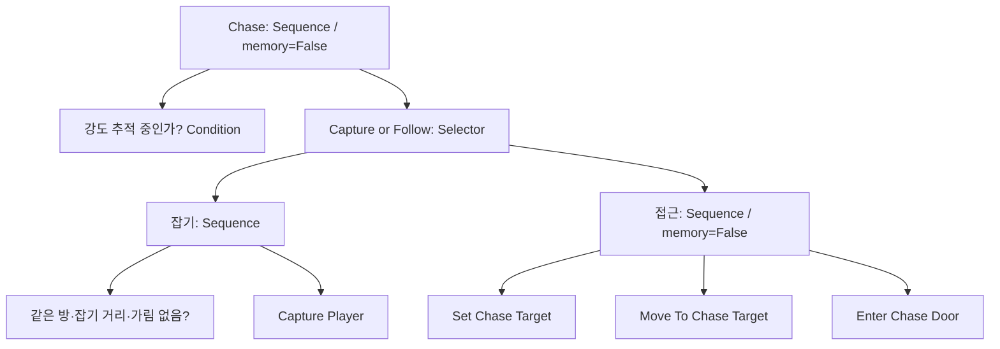
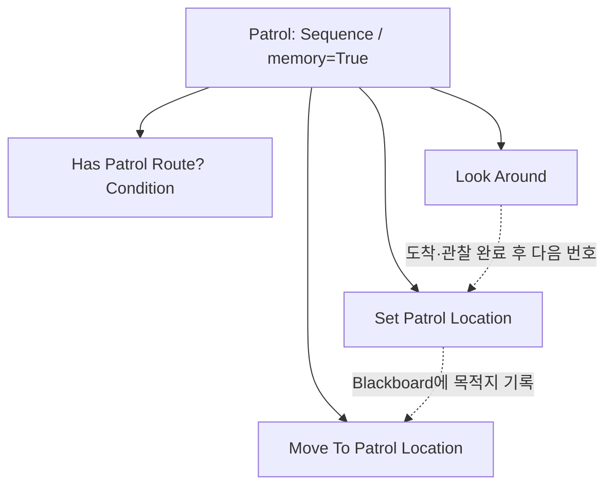

# NPC 행동 트리와 방 사이 추적

[LEC18 인공지능 강의](https://github.com/star0905/2DGP-2022182008/blob/main/Slides/LEC18_%EC%9D%B8%EA%B3%B5%EC%A7%80%EB%8A%A5.pdf)의 py_trees 구조를 저택 게임에 적용했다.
15쪽의 memory 옵션, 16쪽의 Blackboard, 42·57쪽의 추적/순찰 우선순위,
59쪽의 중단된 순찰 지점 재개 방식을 참고했다.

강의의 ‘소년이 가까우면 추적’ 조건은 이 게임의 규칙에 맞게
‘강도 루트에서 보석을 얻어 추적이 시작됐는가?’로 바꿨다.
암호 루트의 평상 순찰, 카메라, 의심도 판정은 유지한다.

## 최상위 우선순위

모든 NPC는 별도의 `BehaviourTree`와 Blackboard를 가진다.
루트는 `Selector(memory=False)`로 매 tick 아래 순서대로 선택한다.

| 순서 | 분기 | 조건과 행동 |
|---|---|---|
| 1 | Unavailable | 잠들었거나 working=False이면 Rest. 다른 행동은 중단한다. |
| 2 | Chase | 강도 추적이 활성화됐고 이 NPC가 추적자라면 잡기 또는 접근한다. |
| 3 | Patrol | 지정된 순찰 경로가 있으면 해당 목적지로 이동하고 주변을 살핀다. |
| 4 | Local Movement or Idle | 주인의 짧은 이동, 사진작가의 장비 점검 중 이동 등 기존 기본 동작을 수행한다. |

Condition은 SUCCESS 또는 FAILURE, 이동 Action은 이동 중 RUNNING,
도착하면 SUCCESS, 경로를 찾지 못하면 FAILURE를 반환한다.

## 추적 트리



- CanChase는 강도 여부, 추적 활성화, 반응 시간, 해당 NPC의 추적자 포함 여부를 검사한다.
- CanCapture는 같은 방, 거리 22픽셀 미만, 가구 가림 없음, 문 전환 보호 시간 종료를 검사한다.
- SetChaseTarget은 같은 방이면 주인공, 다른 방이면 연결된 다음 문 안쪽을 목표로 기록한다.
- MoveToChaseTarget은 기존 A* 경로로 가구를 피하며 초당 150픽셀로 이동한다.
- EnterChaseDoor는 실제로 문 앞에 도착했을 때 다음 방의 입구로 전환한다.
- 문 전환 뒤 0.65초 보호, 최초 1.5초 반응 시간은 유지한다.
- 목표 방이 바뀌면 경로를 즉시 재계산한다. 같은 방의 이동 목표는 매 tick 갱신하며 경로 계산 주기는 0.35초다.

잡기 조건이 실패하면 접근 분기를 실행한다. 이동이 RUNNING이면 다음 프레임에
Chase 조건부터 다시 검사한다. 도착해도 곧바로 순찰하지 않고 추적을 계속한다.

## 순찰 트리



SetPatrolLocation은 현재 patrol_index의 방과 위치를 Blackboard에 기록한다.
이동 중에는 memory=True로 MoveToPatrolLocation을 이어서 실행한다.
LookAround까지 완료해야 다음 지점 번호로 넘어간다.

추적이나 수면이 순찰을 중단하면 해당 하위 트리는 INVALID가 된다.
이때 옛 이동 경로만 지우고 patrol_index는 유지한다.
순찰이 다시 선택되면 가던 지점을 재설정하고 현재 위치에서 경로를 새로 찾는다.

## 캐릭터별 배정

| 캐릭터 | 평상시 분기 | 강도 보석 획득 후 |
|---|---|---|
| 집주인 김재현 | 금고실 내 짧은 기본 이동 | 추적자에 포함하지 않음 |
| 선수 박준혁 | 복도 ↔ 현관 순찰. 수면 커피를 받으면 Rest | 현재 강도 개시 조건에서 이미 잠든 상태이므로 추적하지 않음 |
| 보안 전문가 이도현 | 보안실 ↔ 경비 구역 순찰 | Chase |
| 파티 총무 한지우 | 연회장 ↔ 서재 순찰 | Chase |
| 사진작가 정수빈 | 연회장 여러 지점 순찰. 유도 시 서재에서 45초간 장비 점검 | Chase |
| 요리사 서유진 | 주방 ↔ 연회장 순찰 | 평상 행동 유지 |

## Blackboard와 실행 위치

- `npc_ai.py`: Condition/Action 클래스와 트리 구성.
- `npc.py`: NPC당 NPCBrain과 `bt` 생성. 평상시 update에서 tree를 tick.
- `pursuit.py`: 추적 시작·반응 시간·참가자·문 전환 보호 시간 관리. 추적자는 여기서 같은 tree를 tick.
- `play_mode.py`: 재시작/모드 종료 시 NPC Blackboard 정리.
- `target_room`, `target`, `target_door`를 기록 노드는 WRITE, 이동 노드는 READ로 등록한다.
- `/npc/캐릭터/인스턴스번호` namespace를 사용해 서로의 목표가 섞이지 않게 한다.
- 일반 이동과 추적 이동이 한 프레임에 두 번 실행되지 않도록 tick 주체를 구분한다.
- 대화·수첩·현장 조사 중에는 기존과 같이 AI 갱신도 멈춘다.

디버깅할 때 `npc.brain.debug = True`로 설정하면 강의처럼 상태가 바뀔 때만
콘솔에 트리를 출력한다. `npc.brain.snapshot()`으로 현재 상태 문자열도 확인할 수 있다.
게임 HUD에는 디버깅 정보나 목적지 마커를 추가하지 않았다.

## 실행과 검증

```bat
py -m pip install -r requirements.txt
py main.py
```

추가 라이브러리는 `py_trees>=2.6,<3`이다.
`python tests/headless_verify.py`는 기존 게임 검사에 더해 우선순위 전환,
수면 중단, 중단 지점 재개, NPC별 Blackboard 분리와 종료 시 정리를 검사한다.
